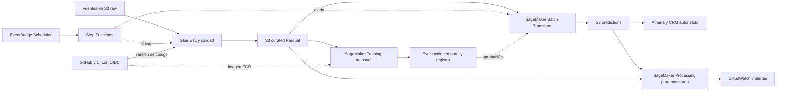

# Arquitectura propuesta en AWS

Diseño para fuentes en S3. No se crearon ni desplegaron recursos. La versión
actual del modelo es un candidato de evaluación, no un modelo aprobado.

## Flujo diario

1. S3 raw recibe objetos inmutables con `event_date`, `ingestion_date`, esquema
   y manifiesto. Se conserva el identificador de origen para deduplicar.
2. EventBridge Scheduler inicia Step Functions con `run_date` y `run_id`.
3. Glue valida esquema, claves, nulos, frescura y relaciones. Los controles
   críticos detienen la ejecución; los registros inválidos se aíslan con motivo.
4. Glue conserva la primera orden histórica por cliente. Para nuevas primeras
   órdenes construye variables congeladas a t0, sin usar navegación posterior.
   El atraso de batch implica una decisión comercial posterior a t0, aunque las
   variables siguen representando t0. El SLA concreto lo acuerda negocio.
5. S3 curated almacena Parquet particionado por fecha y versión de features.
6. Batch Transform carga una imagen de ECR y el pipeline aprobado del registro.
   El procesamiento y el modelo se versionan juntos para evitar diferencias
   entre entrenamiento y predicción.
7. S3 predictions guarda cliente, t0, score, versión, corte y run_id. Se publica
   un manifiesto de éxito tras validar unicidad y probabilidades entre cero y uno.
8. Athena consulta la salida y el CRM recibe solo los registros necesarios,
   sujeto a consentimiento, permisos y reglas de elegibilidad comercial.

## Reintentos y publicación

La clave lógica es `(user_id, first_order_at, feature_version, model_version)`.
Los reintentos escriben en staging para el mismo run_id determinista. El paso
de publicación reemplaza el snapshot lógico y actualiza el manifiesto activo
solo después de validar todo el lote. El consumidor lee únicamente manifiestos
exitosos. No se agrega la misma predicción dos veces por reejecutar.

## Entrenamiento y aprobación

Programación mensual, o análisis extraordinario si cambia el esquema o aparece
drift. Se incorporan únicamente cohortes con 60 días maduros más una tolerancia
de llegada tardía definida con datos reales. Entrenamiento, validación y test
respetan el tiempo y la madurez de etiquetas. AP, lift, calibración, latencia,
calidad y criterios comerciales condicionan la promoción. Se conserva la
versión previa y un mecanismo de rollback. La política ilustrativa local exige
al menos 10% de mejora relativa de AP y lift top20 >=1,20 en validación. Estos
valores son una propuesta y deben acordarse con negocio. El candidato actual
no supera ese gate y no debe activarse automáticamente.

## Monitoreo

| Control | Frecuencia propuesta | Respuesta |
|---|---|---|
| Esquema, claves, cruces y rangos | Cada lote | Bloquear publicación ante errores críticos |
| Frescura y volumen | Cada lote | Alertar por atraso o caída frente a bandas históricas |
| Nulos y cobertura de features | Cada lote | Comparar con entrenamiento y abrir investigación |
| Distribución de score y drift | Diario o semanal | Analizar PSI o pruebas de distribución con tamaño mínimo |
| AP, lift, Brier y tasa base | Cohortes maduras a 60 días | Comparar contra baseline y ventanas recientes |
| Margen y efecto incremental | Piloto comercial | Mantener control aleatorio y medir impacto |

Se propone un job de SageMaker Processing con validaciones en Python y métricas
publicadas en CloudWatch, reportes en S3 y alertas por SNS. Esto evita depender
de la disponibilidad de Model Monitor para una nueva cuenta. Umbrales de
alerta se calibran con historia; PSI 0,2 o cambios de nulos de 5 puntos serían
señales iniciales ilustrativas, no reglas universales ni prueba de degradación.

## Código y linaje

GitHub versiona SQL, Python y configuración. Un workflow de CI valida datos
de prueba, ejecuta smoke tests y construye imagen ECR con digest inmutable.
OIDC asume roles IAM de alcance mínimo. S3 usa cifrado y control de acceso.
Manifiesto: commit SHA, versión de dependencias, hash de datos, parámetros,
fechas de etiquetas, features, modelo, métricas y responsable de aprobación.
Los datos no se suben como secretos ni se guardan credenciales en Git.

## Snowflake opcional

Stage externo sobre S3, carga con COPY INTO o Snowpipe. Tasks y SQL generan la
tabla por cliente y checks. Se exportan features a S3 para entrenamiento y
scoring en SageMaker. Se cargan probabilidades a Snowflake con MERGE por clave
lógica. Se debe elegir un dueño único para cada transformación para evitar
mantener lógica distinta en Glue y Snowflake. Revisar pruning de microparticiones,
columnas consultadas, tamaño y autosuspensión del warehouse. Un cluster key
se justifica por costo y patrón de consulta, no se aplica por defecto.

## Referencias

- https://docs.aws.amazon.com/sagemaker/latest/dg/batch-transform.html
- https://docs.aws.amazon.com/step-functions/latest/dg/using-eventbridge-scheduler.html
- https://docs.aws.amazon.com/sagemaker/latest/dg/model-monitor-data-capture-batch.html
- https://docs.snowflake.com/en/user-guide/data-load-s3-copy

Consultadas el 25/10/2026. Las frecuencias, gates y SLA son propuestas para discusión.
